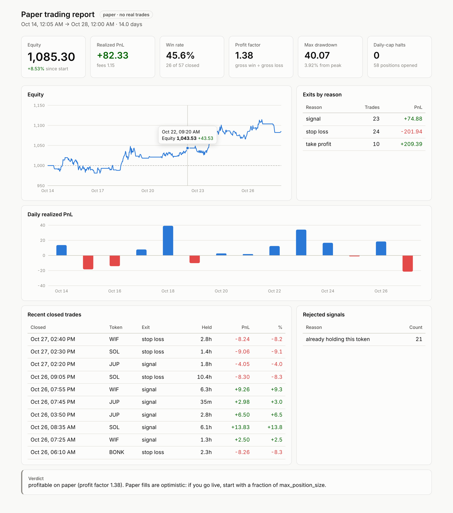

# ultrachain-bot

A signal-following trading bot for Ultrachain (Solana-based). It reads buy and sell signals from your tracker, prices each trade through the [Jupiter](https://dev.jup.ag) swap API, and applies hard risk limits.

**It only paper trades.** It asks Jupiter for the real route and output amount it would get, records that as the fill, and never signs or sends a transaction. `mode = "live"` is refused at startup on purpose. Run it for a week or two, then read `report`.



*The `report --html` dashboard, shown with **simulated** demo data from `scripts/demo-ledger.py`. These are not results from a real strategy.*

## Quick start

```sh
cp config.example.toml config.toml   # edit tokens, signal source, limits
cargo run --release -- run            # leave running; Ctrl-C to stop
cargo run --release -- report         # any time, even while running
cargo run --release -- report --html data/dashboard.html   # same, plus a dashboard page
```

The dashboard is a single offline HTML file. It shows equity over time, daily PnL, exits by reason, recent trades and rejected signals, with hover tooltips and light and dark mode. To preview it without a real run:

```sh
scripts/demo-ledger.py data/demo-ledger.jsonl
cargo run -- report -l data/demo-ledger.jsonl --html data/dashboard.html
```

Restarts are safe. Positions, cash, the daily baseline and the signal ids already seen are saved to `data/state.json` after every tick. Every event is appended to `data/ledger.jsonl`.

## Tracker signals

The tracker sends one JSON object per signal:

```json
{"id": "sig-123", "ts": "2026-10-30T12:00:00Z", "token": "BONK", "side": "buy", "strength": 0.7}
```

- `token` can be a symbol or a mint, and must be listed under `[[tokens]]`.
- `id` is used to drop duplicates, so a feed can safely send the same signal again.
- `strength` is optional, between 0 and 1. It can only make the position smaller than `max_position_size`, never larger.
- A signal older than `max_signal_age_secs` is rejected and logged.

There are two ways to connect the tracker (`[signals]`):
- `kind = "file"` reads new lines as the tracker appends them to a JSON-lines file. It copes with partial lines and with the file being rotated.
- `kind = "http"` polls a URL that returns a JSON array of signals.

## Risk limits (`[risk]`)

| Limit | Behaviour |
|---|---|
| `max_position_size` | Hard cap on the quote token (USDC) put into one position. The size is also limited by cash, after keeping back the fees for entry and exit. |
| `max_open_positions` | Further buy signals are rejected once this many positions are open. A second buy for a token already held is also rejected. |
| `stop_loss_pct` | Each tick, every position is priced at what selling it right now would return (a real Jupiter quote, after the exit fee). The position is closed if it is at or below `-stop_loss_pct`. |
| `take_profit_pct` | Optional. Works the same way, for gains. |
| `daily_loss_cap` | Daily PnL is equity now minus equity at 00:00 UTC, so it counts both realized and unrealized losses. When it reaches `-daily_loss_cap`, new entries stop until the next UTC day. With `flatten_on_daily_cap` (on by default), every open position is also closed. |
| `max_price_impact_pct` | Entries whose quote has a worse price impact are skipped. Exits are never blocked. |
| `est_fee_per_swap` | A fixed cost subtracted from every paper fill, so the results are not flattering. |

No risk check ever blocks an exit. If an exit quote fails, the position stays open and the bot tries again on the next tick.

## What gets logged

`data/ledger.jsonl` has one event per line:
- `open` and `close` record each would-be trade: spend or proceeds, quantity, effective price, price impact, route, and for closes the PnL, holding time and exit reason.
- `reject` records a signal that was not acted on, and why.
- `halt` records a daily-cap trip.
- `equity` is a snapshot taken every 5 minutes and after every trade.

`report` turns this into win rate, realized PnL, expectancy, average win and loss, profit factor, max drawdown, PnL by exit reason and by day, and counts of rejections. It ends with a verdict. Under 30 closed trades the verdict is always "keep paper trading".

## Caveats before trusting the numbers

- **Paper fills are optimistic.** A fill is the quoted `outAmount`. There is no latency, no failed transactions, and no MEV.
- **Stops can slip past their level.** Stops are checked once per tick (`tick_secs`), so a fast move can close a position well beyond the stop level. The ledger records the real exit PnL.
- **Ultrachain liquidity.** Jupiter routes Solana mainnet liquidity. If Ultrachain has its own Jupiter-compatible deployment or aggregator, point `jupiter.base_url` at it. Otherwise these quotes show Solana prices, not Ultrachain ones.
- **Live trading is not built yet.** It needs Jupiter's `/swap` endpoint, transaction signing, submission to an Ultrachain RPC, and confirmation handling. Build it only if `report` shows an edge over a meaningful sample.

## Bridge

`bridge/` deploys a Hyperlane USDC warp route between Ultrachain and Solana mainnet, so funds can move to where Jupiter's liquidity is. See [bridge/README.md](bridge/README.md).

## Development

```sh
cargo test     # risk limits, engine flow (mock quoter), signal tailing, report stats
cargo clippy --all-targets
```
